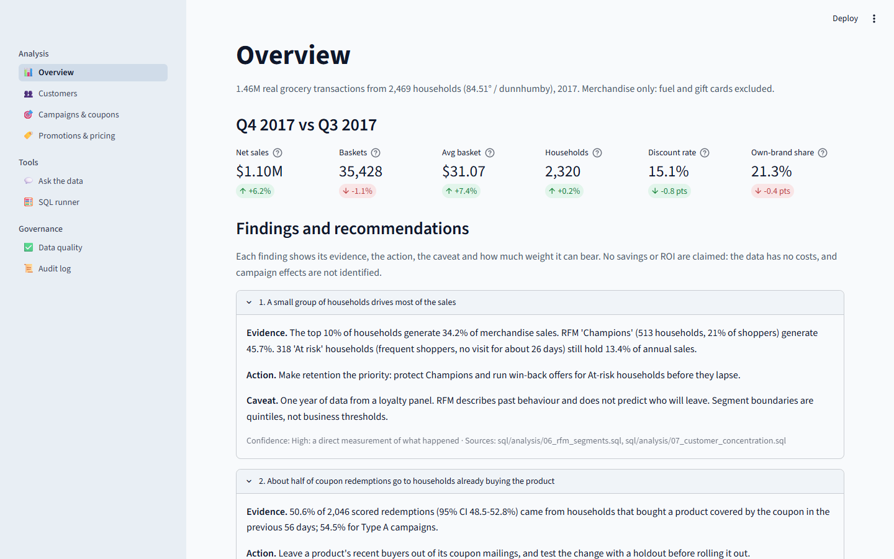
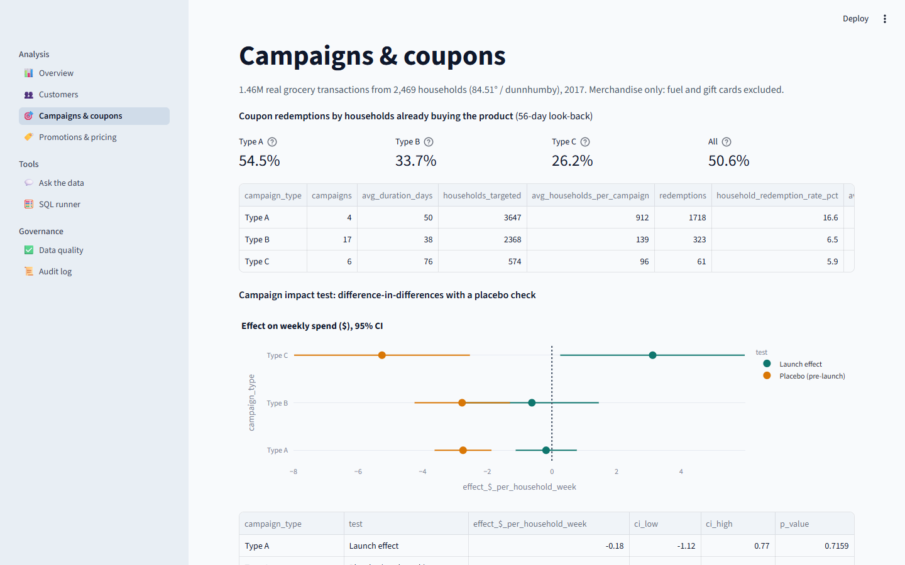
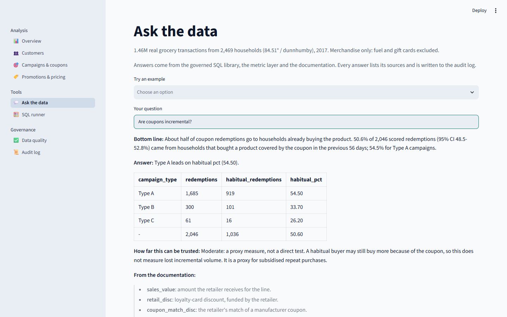

# Grocery Retail Analytics

**Which customers drive sales, do coupons and promotions earn their cost, and what should the business do next?**
An end-to-end analysis of **1.46 million real grocery transactions** from 2,469 households
(84.51° / dunnhumby "The Complete Journey", 2017). It covers a governed DuckDB warehouse,
a SQL analysis library, statistical tests, a Power BI report reconciled to the SQL, and a
Streamlit app.




## Business problem

A grocery retailer spends on loyalty discounts, manufacturer coupon campaigns and in-store
promotions. Management wants to know:

1. **Which customers matter most**, and which are at risk.
2. **Whether coupons and campaigns** lead to extra purchases or only discount purchases that would have happened anyway.
3. **Which promotions and product combinations** are linked to higher sales.
4. **What can be concluded with confidence**, and what needs more evidence before acting.

## Dataset and limitations

| | |
|---|---|
| Source | "The Complete Journey" (84.51° / dunnhumby), from the CC0 [`completejourney`](https://github.com/bradleyboehmke/completejourney) package. Downloaded at build time with checksums; not stored in this repo |
| Scope | 2017: 1,469,307 transaction lines, 2,469 households, 92,331 products, 27 campaigns, 2,102 coupon redemptions, 20.9M promotion records |
| Demographics | 801 of 2,469 households (32%) |

**Limitations**, also shown on the Power BI Recommendations page:

- **Panel, not store totals.** Sales are the purchases of loyalty-panel households, not total store sales.
- **No cost or margin data,** so there is no profitability analysis and no ROI or savings estimates.
- **One year only,** so no year-over-year comparison and no reliable seasonality model.
- **Not randomised.** Promotions and campaigns were not randomly assigned, so lifts are associations (upper bounds), and campaign effects turn out to be **not identifiable** (finding 3).

## Findings and recommendations

Generated from the data by `python -m retail.findings`. The full text is in
[`reports/findings.md`](reports/findings.md).

| # | Finding | Evidence | Recommended action | Caveat | Confidence |
|---|---|---|---|---|---|
| 1 | **A small group of households drives most of the sales** | Top 10% of households = 34.2% of sales; RFM Champions (513 households, 21%) = 45.7%; 318 at-risk frequent shoppers hold 13.4% | Prioritise retention: protect Champions, run win-back offers for at-risk households | RFM describes past behaviour and doesn't predict churn; one year of panel data | High (descriptive) |
| 2 | **About half of coupon redemptions go to households already buying the product** | 50.6% of 2,046 scored redemptions (95% CI 48.5–52.8%) followed a purchase of the same product in the prior 56 days; 54.5% for Type A | Leave a product's recent buyers out of its coupon mailings, and test the change with a holdout | A proxy: habitual buyers may still buy more because of the coupon | Moderate (proxy) |
| 3 | **The data can't show whether campaigns increase spending** | Difference-in-differences vs 910 never-targeted households fails its placebo test for 3 of 3 campaign types: targeted households were already spending up to $5.26/week less before launch | Hold out a random 10% of every target list so ROI becomes measurable | This doesn't mean campaigns fail; current targeting makes the effect impossible to separate from existing trends | Can't conclude |
| 4 | **A display plus a mailer is linked to far higher sales than either alone** | Against the same product in the same store, unpromoted weeks: mailer +131%, display +129%, both **+225%** (95% CI 220–231%) | Pair mailer features with in-store displays, and confirm with a controlled store test | Promotions are chosen, not random, so this is an upper bound, not a causal lift | Moderate (association) |
| 5 | **Fresh-produce and meal-ingredient categories are bought together** | Onions + potatoes lift 4.6; onions + other vegetables 4.5; onions + tomatoes 4.5 | Co-locate or bundle these as meal solutions, and track basket size | Co-purchase isn't causation; category level only | High (descriptive) |

## Power BI report

[`powerbi/Retail_Analytics.pbip`](powerbi/Retail_Analytics.pbip) has five business pages
and a drill-through page:

| Page | What it answers |
|---|---|
| 1. Executive Overview | Q4 net sales, transactions, basket value, households and discount rate vs Q3; weekly trend with 4-week rolling average |
| 2. Customer Analytics | RFM segments (share of sales, sales per household), repeat behaviour, top-10% concentration, income and household composition |
| 3. Product Analytics | Department and category contribution, reach (penetration) and own-brand share; categories bought together; top product types |
| 4. Promotion Effectiveness | Deal dependence, coupon redemptions by existing buyers, promotion lift with CIs, campaign impact test with placebo |
| 5. Business Recommendations | The five findings above with action, caveat and confidence, plus limitations |
| Department Detail | Drill-through: right-click a department to open its trend, categories, penetration and own-brand share |

- **The model** is a star schema: a Sales fact with Product, Household and Date dimensions (Date is marked as the date table), plus coupon, campaign and results tables. It holds **37 DAX measures** in display folders, every chart carries a tooltip with supporting measures, and **the report is generated from code** ([`powerbi/tools/build_report.py`](powerbi/tools/build_report.py)), so the layout is reviewable in a diff.
- **Reconciled with SQL: 58 of 58 values match.** Each Power BI measure value was captured from the live model and recomputed independently in SQL. See [`reports/reconciliation.md`](reports/reconciliation.md); a test repeats the comparison on every run.
- **Verification caught three DAX bugs, all fixed:**
  - A `CALCULATE` filter argument that ignored row context, which inflated a redemption rate from 6.5% to 83%.
  - An off-by-one top-10% decile.
  - A name clash between a measure and a column.

To open it: run the pipeline, open the `.pbip` in Power BI Desktop, set the `DataFolder`
parameter (Transform data → Manage parameters) to your `powerbi/data/` folder, then
Refresh.

## Why the numbers can be trusted

| Evidence | Where |
|---|---|
| Table grain, keys, row counts and relationships | [`docs/data_model.md`](docs/data_model.md) |
| 24 automated quality checks, and how each issue is handled | [`docs/data_quality.md`](docs/data_quality.md) |
| Every KPI's definition, with its SQL and its DAX side by side | [`docs/kpi_definitions.md`](docs/kpi_definitions.md) |
| Sample SQL queries with their expected output | [`docs/sql_examples.md`](docs/sql_examples.md) |
| Power BI ↔ SQL reconciliation (58/58) | [`reports/reconciliation.md`](reports/reconciliation.md) |
| Methods: difference-in-differences, Wilson and bootstrap intervals | [`docs/methodology.md`](docs/methodology.md) |

Real-data problems the pipeline handles, each enforced by the quality gate:

- **UTC timestamps.** Source timestamps are UTC, while the stores trade on US Eastern time. A fixed cut-off put 785 rows in the wrong week during daylight saving time. The fix reproduces the retailer's own week number on every one of the 1.46M rows.
- **Fuel quantities aren't units.** Fuel lines record gallons or odometer readings, up to 89,638.
- **Gift card activations aren't revenue,** so they're excluded from merchandise sales.
- **Unknown products.** 4,836 lines reference products missing from the master. They're quarantined, not deleted, and landing = fact + quarantine reconciles to the cent.
- **Duplicates and gaps.** The coupon master has 1,623 duplicate rows; promotion listings are duplicated and include promoted weeks only.
- **Random segment assignment.** RFM quintiles assigned tied households to segments arbitrarily, so segments changed between runs. A deterministic tie-breaker fixed it.

## Architecture and stack

```text
 completejourney (CC0)    ingest.py           sql/models (dbt-style)                  quality.py
 8 R files, SHA-256  ──► Parquet landing ──► staging ─► marts ─► segments  ──►  24 checks (errors block)
                                                         │
          metrics.py (one definition per KPI)            ▼
          sql/analysis/*.sql (13 queries)  ──►  DuckDB warehouse  ──►  stats.py (DiD, Wilson, bootstrap)
                                                         │
     ┌───────────────────┬──────────────────┬────────────┼─────────────────┬────────────────────┐
  findings.py        Streamlit app      copilot.py   export_powerbi.py   reconcile.py        docs_gen.py
  5 findings         8 pages            governed,    Parquet ─► Power BI  DAX = SQL (58/58)   trust docs
                                        cited                (TMDL + PBIR)
```

**Stack:** Python 3.11, DuckDB, SQL, pandas, SciPy and statsmodels, Power BI (DAX, TMDL,
PBIR), Streamlit and Plotly, pytest, ruff, GitHub Actions and Docker.

## SQL example

Coupon redemptions by households already buying the product
([`sql/analysis/10_coupon_incrementality.sql`](sql/analysis/10_coupon_incrementality.sql)):

```sql
SELECT
  CASE WHEN GROUPING(campaign_type) = 1 THEN 'All' ELSE campaign_type END AS campaign_type,
  COUNT(*) AS redemptions,
  COUNT(*) FILTER (WHERE is_habitual) AS habitual_redemptions,
  ROUND(100.0 * COUNT(*) FILTER (WHERE is_habitual) / COUNT(*), 1) AS habitual_pct
FROM mart_coupon_redemptions
WHERE is_scored
GROUP BY ROLLUP (campaign_type)
ORDER BY GROUPING(campaign_type), campaign_type;
```

| campaign_type | redemptions | habitual_redemptions | habitual_pct |
|---|---:|---:|---:|
| Type A | 1,685 | 919 | 54.5 |
| Type B | 300 | 101 | 33.7 |
| Type C | 61 | 16 | 26.2 |
| All | 2,046 | 1,036 | 50.6 |

The library has 13 analyses: quarterly KPIs, the weekly trend, a department scorecard,
the own-brand gap, deal dependence, RFM segments, customer concentration, demographics,
campaign reach, coupon incrementality, promotion lift, market basket and shopping times.

## Streamlit app and copilot

| | |
|---|---|
|  |  |
| Campaign impact test: each launch effect next to its failed placebo | Copilot: bottom line, governed SQL result and confidence caveat |

**The copilot is a supporting feature.** It answers from the approved SQL library, the
metric layer or the documentation. It refuses questions the data can't answer (margin,
forecasts, other years, information outside the dataset), blocks write requests and prompt
injection, and attaches the confidence caveat to answers about associations. Its database
connection is read-only with file access disabled. See
[`docs/copilot_safety.md`](docs/copilot_safety.md), which is generated from its real
responses. A 24-question evaluation gates CI. All 24 pass, including 7 refusal cases (unsupported,
write and injection) and 3 checks that caveats are attached.

## What runs where

| | Where |
|---|---|
| Source code, SQL, docs, findings, reconciliation, screenshots | This GitHub repo |
| CI (lint, unit tests, full pipeline on real data, eval gate) | GitHub Actions, on every push |
| Streamlit app | Locally (`streamlit run app.py`); no hosted demo yet |
| Power BI report | Locally, in Power BI Desktop (free, Windows) |

## Run it locally

```bash
python -m venv .venv
# Windows: .venv\Scripts\activate    macOS/Linux: source .venv/bin/activate
pip install -r requirements-dev.txt
set PYTHONPATH=src                   # macOS/Linux: export PYTHONPATH=src
python -m retail.pipeline            # download, build, quality gate, stats, findings, report, Power BI export
streamlit run app.py
```

```bash
pytest -q                            # unit tests on SQL fixtures plus warehouse and reconciliation tests
python -m retail.evaluate --min 0.9  # copilot scorecard
python -m retail.docs_gen            # regenerate the trust docs
```

On machines with less than about 8 GB of RAM, set `RETAIL_SKIP_TABLES=promotions` (CI does
this). Stop the Streamlit app before rebuilding: DuckDB locks the warehouse file while it is
open.

## Data and attribution

"The Complete Journey" by 84.51° (dunnhumby), via the CC0-licensed `completejourney`
package. Raw data is downloaded at build time and is not stored in this repository.
