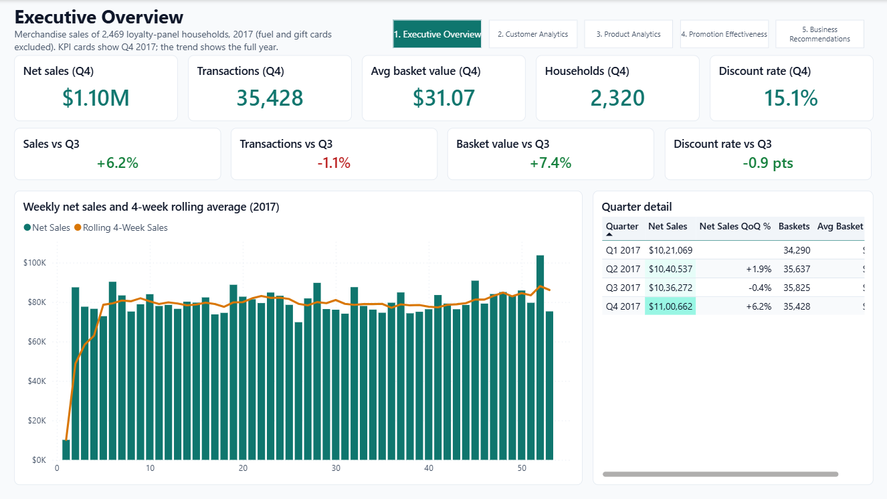
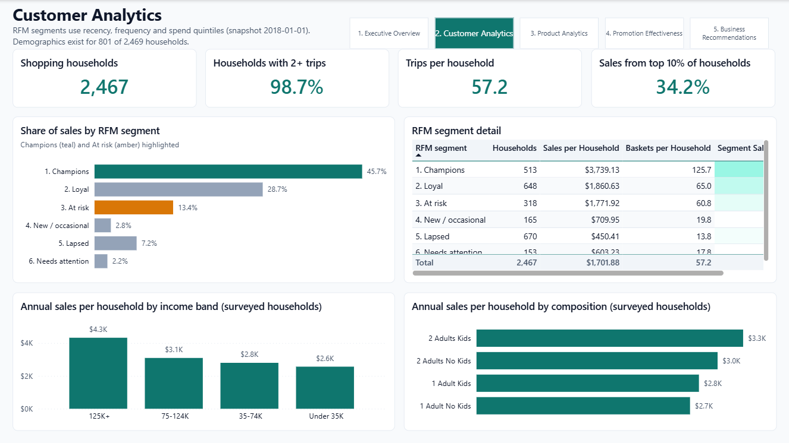
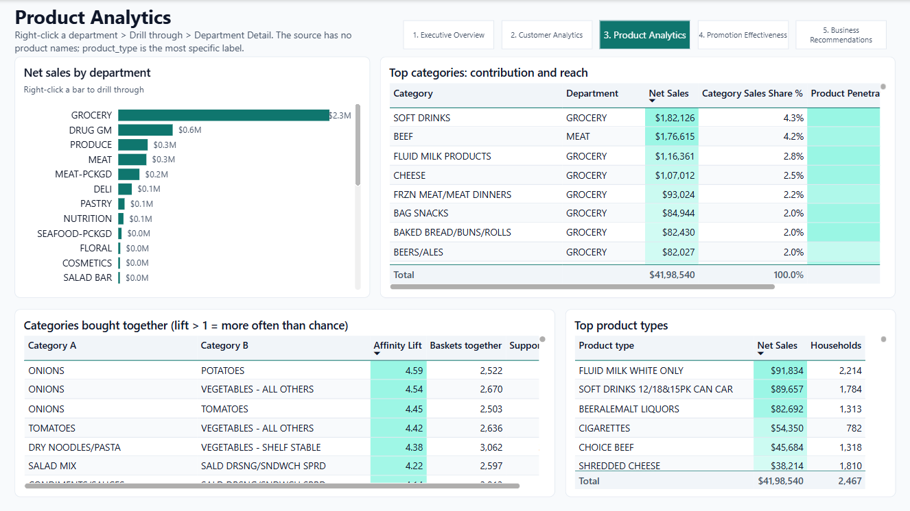
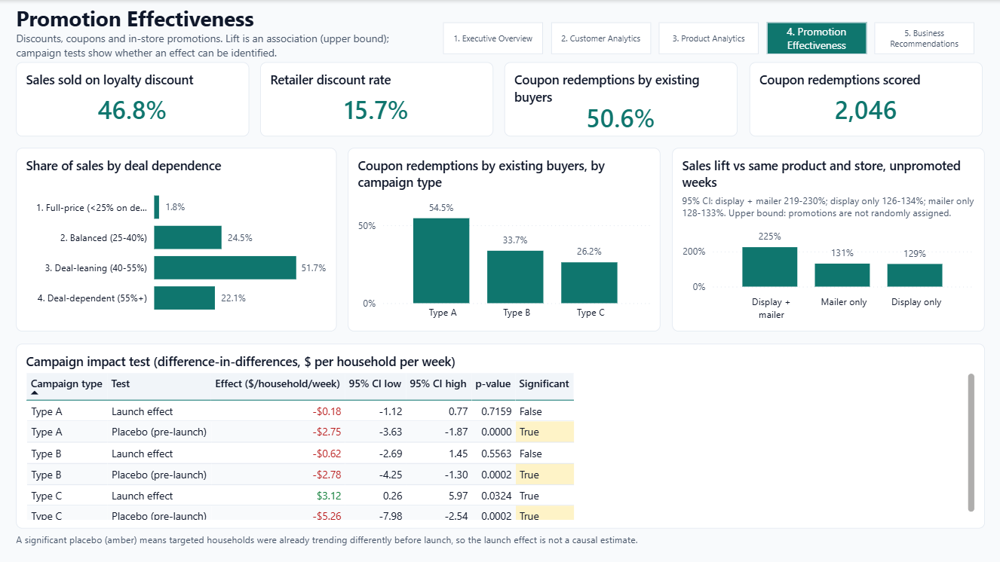
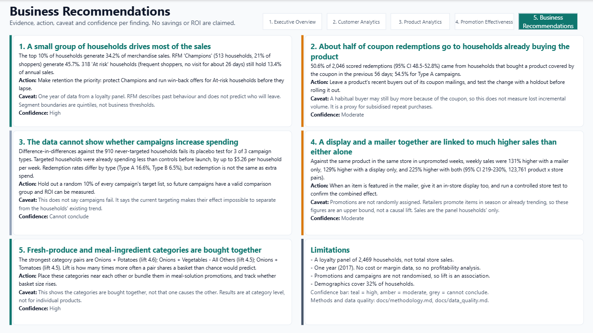

# Grocery Retail Analytics




A grocery retailer spends heavily on loyalty discounts, coupon campaigns and in-store
promotions. I wanted to find out which customers actually drive the business and whether
that promotional spending is changing behaviour or mostly discounting purchases that would
have happened anyway.

To answer that, I worked with **1.46 million real transactions** from 2,469 households over
a full year, from 84.51° / dunnhumby's *The Complete Journey* dataset. The project covers the
full analyst workflow: cleaning and validating the data, building a reliable data model,
analysing it in SQL, testing the claims statistically, and presenting the results in a
Power BI report for a business audience.

---

## What I found

**1. A small group of households carries the business.**
The top 10% of households generate 34.2% of sales. The "Champions" segment from my RFM
analysis is only 21% of households but brings in 45.7% of sales. Another 318 frequent
shoppers haven't visited in about four weeks, and they still account for 13.4% of annual
sales. That makes them the obvious first target for a win-back offer.

**2. About half of coupon redemptions go to people who were already buying the product.**
Of 2,046 redemptions I could score, 50.6% (95% CI 48.5–52.8%) came from households that had
bought the same product in the previous 56 days. For the large Type A campaigns the figure
is 54.5%. My recommendation is to stop sending a product's coupon to its recent buyers, and
to test that change before rolling it out. The caveat: this is a proxy. A regular buyer
might still buy *more* because of a coupon, and this data can't show that.

**3. The data can't tell us whether the campaigns work, and that is a finding in itself.**
I compared targeted households with the 910 that were never targeted, using
difference-in-differences. The model includes a placebo check on the period *before*
launch, and that check failed for all three campaign types: targeted households were
already spending less than everyone else (up to $5.26 per household per week) before any
campaign started. The retailer is effectively aiming campaigns at shoppers who are already
drifting away, so any "lift" is mixed up with that trend. The fix is cheap: hold back a
random 10% of each target list. Without it, campaign ROI will stay unmeasurable.

**4. Displays and mailers work far better together than alone.**
Comparing the same product in the same store against its unpromoted weeks, a mailer alone
is linked to 131% higher sales, a display alone to 129%, and both together to **225%**
(95% CI 220–231%). Promotions aren't randomly assigned, so treat these figures as upper
bounds rather than proven effects. The direction is still clear enough to act on, ideally
backed by a proper store test.

**5. Shoppers buy meal ingredients together.**
Onions and potatoes appear in the same basket 4.6 times more often than chance would
predict, followed closely by onions with other vegetables and with tomatoes. That points to
meal-bundle promotions or placing those categories near each other in store.

I've kept every number in this README traceable. The findings are generated from the data
by code ([`reports/findings.md`](reports/findings.md)), and none of them are typed by hand.
The data has no costs or margins, so I haven't estimated savings or ROI anywhere.

---

## The Power BI report

The report has five pages, each built around a single business question, plus a
drill-through page for individual departments.

### Executive Overview: how is the business doing this quarter?


Q4 sales reached $1.10M, up 6.2% on Q3. Transactions actually *fell* 1.1%, so the growth
came entirely from bigger baskets (+7.4%). The change cards use green and red, except the
discount rate, where a drop is good news and the colours are reversed.

### Customer Analytics: who drives value?



RFM segments with the two that matter most highlighted: Champions in teal and At risk in
amber. Below them, spend by income band and household type for the 801 households that
completed the demographic survey.

### Product Analytics: what sells, and what sells together?



Department and category contribution, how many households each category reaches, and the
strongest basket pairs. Right-click any department to drill through to its own detail page.

### Promotion Effectiveness: is the discount spend working?



46.8% of sales are made on a loyalty discount. The campaign test table highlights the failed
placebo checks in amber, so the reason campaign ROI can't be measured is visible at a glance.

### Business Recommendations: what should we do, and how sure are we?



Each finding comes with its evidence, a recommended action, its caveat and a confidence
level, shown as a coloured bar: teal for high, amber for moderate, grey for "can't
conclude".

**Behind the report:**
- A star schema (a Sales fact with Product, Household and Date dimensions) with 44 DAX measures: 37 business measures plus 7 that drive the conditional formatting.
- A custom theme and a written design spec ([`docs/powerbi_design_guide.md`](docs/powerbi_design_guide.md)).
- The report layout is generated from code ([`powerbi/tools/build_report.py`](powerbi/tools/build_report.py)), so every change can be reviewed like any other code change.

**Checking DAX against SQL.** I didn't want the dashboard to quietly disagree with the
analysis, so I recomputed 58 of the report's values independently in SQL. All 58 match
([`reports/reconciliation.md`](reports/reconciliation.md)), and a test re-checks them on
every run. The process caught three DAX bugs on the way:
- A `CALCULATE` filter that ignored row context. It made one redemption rate show 83% instead of 6.5%.
- An off-by-one error in the top-10% calculation.
- A measure whose name clashed with a column name.

---

## Cleaning real data

Most of the work was making the data trustworthy. Real data comes with problems, and these
were the main ones:

- **Timestamps were in UTC, but the stores trade on US Eastern time.** My first version used a fixed cut-off hour, and the quality checks flagged 785 rows landing in the wrong week around the daylight-saving change. After converting properly, every one of the 1.46M rows matches the retailer's own week numbering.
- **Fuel "quantities" aren't units.** They're gallons or odometer readings, some as high as 89,638. I kept fuel sales but excluded fuel from unit counts.
- **Gift card activations aren't revenue,** so they're excluded from merchandise sales.
- **4,836 transactions point to products that don't exist** in the product table. I set them aside in a quarantine table rather than deleting them, and the totals still reconcile to the cent.
- **Duplicates:** 1,623 duplicate coupon rows and 12,785 duplicate promotion listings. The promotions feed also lists only promoted weeks, so I had to build the "not promoted" baseline myself.
- **RFM segments changed from run to run,** because households with tied scores were assigned to segments arbitrarily. A deterministic tie-breaker fixed it.

Every rule is enforced by an automated quality gate with 24 checks. If a serious check
fails, the pipeline stops before anything reaches a dashboard.

| Want to check something? | Look here |
|---|---|
| Tables, grain and relationships | [`docs/data_model.md`](docs/data_model.md) |
| All 24 quality checks and how each issue is handled | [`docs/data_quality.md`](docs/data_quality.md) |
| How every KPI is defined, in SQL and in DAX | [`docs/kpi_definitions.md`](docs/kpi_definitions.md) |
| Example queries with their expected output | [`docs/sql_examples.md`](docs/sql_examples.md) |
| Statistical methods and their limits | [`docs/methodology.md`](docs/methodology.md) |

---

## A sample of the SQL

This query produces finding 2. The "habitual" flag is calculated once in the data model, so
the analysis query itself stays short:

```sql
SELECT
  CASE WHEN GROUPING(campaign_type) = 1 THEN 'All' ELSE campaign_type END AS campaign_type,
  COUNT(*) AS redemptions,
  COUNT(*) FILTER (WHERE is_habitual) AS habitual_redemptions,
  ROUND(100.0 * COUNT(*) FILTER (WHERE is_habitual) / COUNT(*), 1) AS habitual_pct
FROM mart_coupon_redemptions
WHERE is_scored
GROUP BY ROLLUP (campaign_type)
ORDER BY GROUPING(campaign_type), campaign_type;
```

| campaign_type | redemptions | habitual_redemptions | habitual_pct |
|---|---:|---:|---:|
| Type A | 1,685 | 919 | 54.5 |
| Type B | 300 | 101 | 33.7 |
| Type C | 61 | 16 | 26.2 |
| All | 2,046 | 1,036 | 50.6 |

The [`sql/analysis`](sql/analysis) folder holds 13 queries like this, covering quarterly
KPIs, weekly trends, department performance, the own-brand gap, deal dependence, RFM,
customer concentration, demographics, campaigns, coupons, promotion lift, market basket
and shopping times.

---

## The Streamlit app and the "ask the data" assistant

| | |
|---|---|
|  |  |

Alongside Power BI there's a Streamlit app covering the same analysis, plus a SQL runner
and a small question-answering assistant. The assistant is deliberately conservative:

- **It answers only from approved sources:** the SQL library and the project documentation.
- **It cites where each answer came from.**
- **It refuses rather than guesses.** It declines what the data can't answer, such as margins, forecasts or other years.
- **It cannot change anything:** its database connection is read-only, with file access switched off.
- **It flags uncertainty:** answers about associations carry their caveat.

A set of 24 test questions checks it on every push, including requests it is supposed to
refuse. It's a nice extra, but the analysis is the core of the project.

---

## How it's built

```text
raw data (8 files) → cleaning & quality checks → DuckDB data model → SQL analyses → statistical tests
                                                        │
                        ┌───────────────────────────────┼──────────────────────────────┐
                   Power BI report                Streamlit app                 findings & docs
                (checked against SQL)           (+ Q&A assistant)            (generated from data)
```

**Tools:**
- **Data and analysis:** Python, SQL (DuckDB), pandas, SciPy and statsmodels.
- **Reporting:** Power BI (DAX), Streamlit and Plotly.
- **Quality:** pytest, with GitHub Actions running the full pipeline on the real data at every push.

---

## Running it yourself

You need Python 3.11. The pipeline downloads the data itself; a full run takes a few minutes.

```bash
python -m venv .venv
.venv\Scripts\activate              # macOS/Linux: source .venv/bin/activate
pip install -r requirements-dev.txt
set PYTHONPATH=src                  # macOS/Linux: export PYTHONPATH=src
python -m retail.pipeline
streamlit run app.py
```

To open the Power BI report:
1. Open `powerbi/Retail_Analytics.pbip` in Power BI Desktop.
2. Point the `DataFolder` parameter (Transform data → Manage parameters) at your `powerbi/data/` folder.
3. Click Refresh.

Run the tests with `pytest -q`. On a machine with less than about 8 GB of RAM, set
`RETAIL_SKIP_TABLES=promotions` to skip the 20.9-million-row promotions file.

---

## Limitations

There are limits to what this data can show:

- **These are panel households, not total store sales.** The data covers 2,469 loyalty-card households.
- **There's only one year,** so I can't compare years or model seasonality reliably.
- **There's no cost data,** so I can't say anything about margins or profitability.
- **Nothing was randomised:** neither promotions nor campaigns. Promotion lift is an association, not a proven effect, and campaign impact can't be identified at all (finding 3).
- **Demographic answers come from a minority:** only 32% of households have demographic data.

---

## Data

*The Complete Journey* by 84.51° (dunnhumby), via the CC0-licensed
[`completejourney`](https://github.com/bradleyboehmke/completejourney) package. The raw data
is downloaded when you run the pipeline and isn't stored in this repository.

Built by [@Skpkush](https://github.com/Skpkush).
