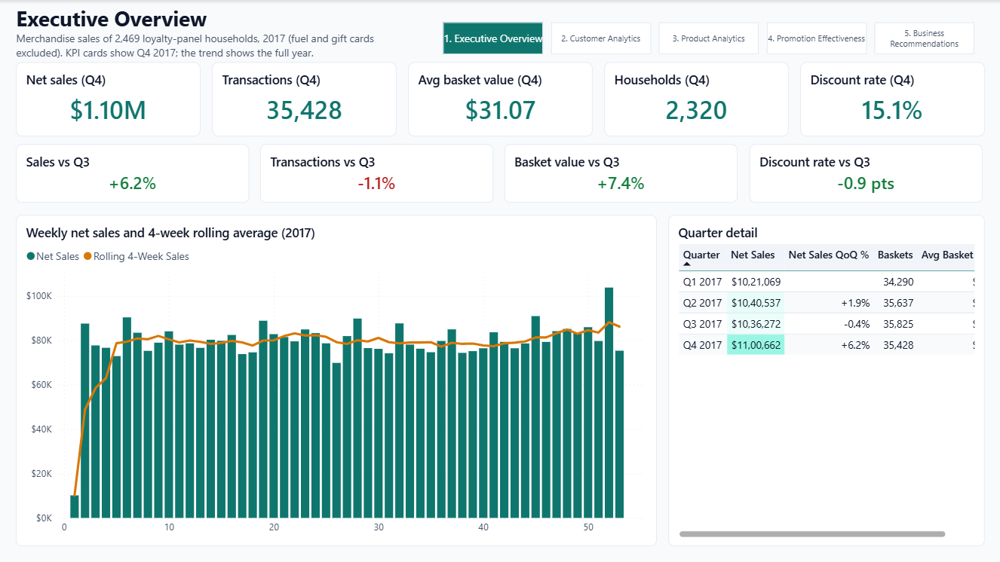
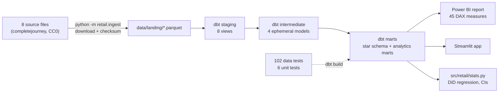
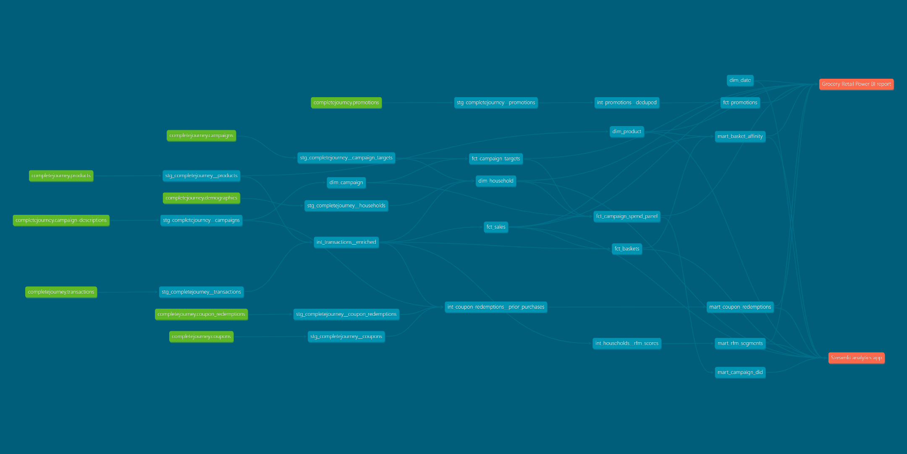
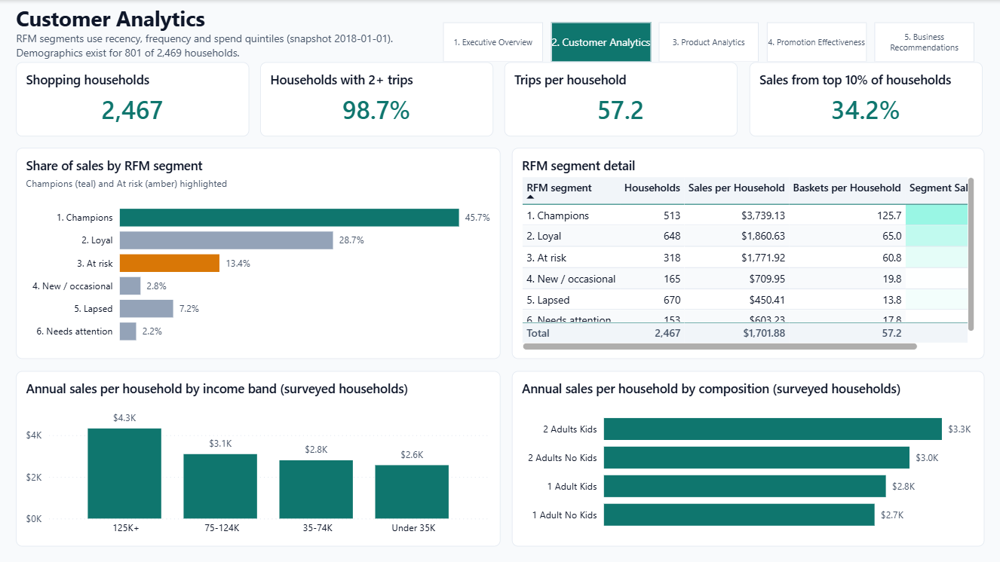
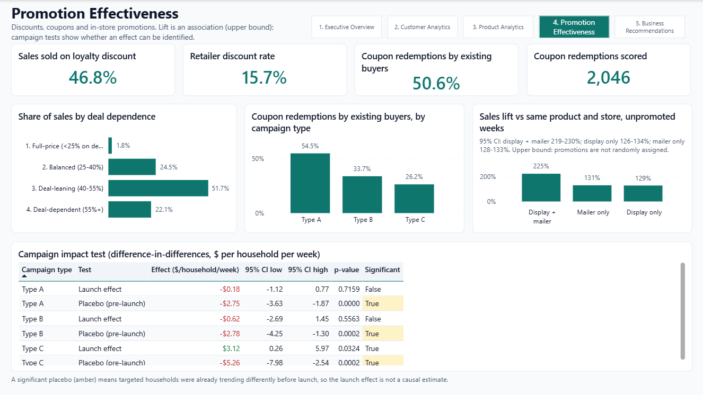

# Grocery Retail Analytics


**A dbt project that models 1.46 million real grocery transactions into a tested star
schema, then uses it to measure whether a retailer's loyalty discounts, coupons and
campaigns change shopping behaviour.**



## The business question

A grocery retailer spends heavily on loyalty discounts, coupon campaigns and in-store
promotions. Which households actually drive the business, and is the promotional
spending changing behaviour, or mostly discounting purchases that would have happened
anyway?

The data is 84.51° / dunnhumby's *The Complete Journey*: 1,469,307 transaction lines from
2,469 loyalty-card households over calendar year 2017, plus products, demographics,
27 campaigns, coupons and 20.9 million promotion listings.

---

## Architecture



dbt-duckdb reads the landed Parquet files directly, so there is no load step and no
cloud cost. `dbt build` runs every model, data test and unit test in dependency order;
an error-level test failure stops the build before anything reaches a dashboard.

### Lineage



*Sources (green) → staging → intermediate → marts → the Power BI report and Streamlit
app, declared as dbt exposures (orange). Generated with `dbt docs generate`.*

| Layer | Models | Materialization | What happens here |
|---|---|---|---|
| `staging` | 8 `stg_completejourney__*` | view | One per source table: rename, cast types, trim text, convert UTC to store-local time. No joins. |
| `intermediate` | 4 `int_*` | ephemeral | Joins and business logic: product flags on each line, promotion de-duplication, RFM scores, prior-purchase look-back. |
| `marts/core` | 5 `dim_*`, 5 `fct_*`, `quarantine_transactions` | table, 2 incremental | The star schema Power BI reads. `fct_sales` and `fct_promotions` are incremental. |
| `marts/analytics` | `mart_rfm_segments`, `mart_coupon_redemptions`, `mart_basket_affinity`, `fct_campaign_spend_panel`, `mart_campaign_did` | table | Segments and test inputs defined once, so they mean the same thing in SQL, Python and Power BI. |

**Incremental strategy.** `fct_sales` (1,464,471 rows) has no line-level key: identical
lines are legitimate (the same item scanned twice). So instead of merging row by row, each
run reloads whole trading days (`delete+insert` on `business_date`), from the latest loaded
date minus a 3-day lookback. Late lines inside that window are picked up without
duplicates. `fct_promotions` (20,927,744 rows) does the same by retail week.

---

## Key findings

All numbers below are produced by the code in this repository on the full dataset
([`reports/findings.md`](reports/findings.md) is generated, not typed). The data has no
costs or margins, so no savings or ROI are claimed.

1. **A small group of households carries the business.** The top 10% of households
   generate 34.2% of merchandise sales. RFM "Champions" are 513 households (21%) and
   45.7% of sales. 318 "At risk" frequent shoppers, about 26 days since their last visit,
   still hold 13.4% of annual sales: the first target for a win-back offer.
2. **About half of coupon redemptions go to shoppers already buying the product.**
   50.6% of 2,046 scored redemptions (95% CI 48.5–52.8%) came from households that bought
   a covered product in the previous 56 days; 54.5% for Type A campaigns. Recommendation:
   leave a product's recent buyers out of its coupon mailing, and test that with a holdout.
3. **The data cannot show whether campaigns increase spending.** A difference-in-differences
   test against the 910 never-targeted households fails its placebo check for all three
   campaign types: targeted households were already spending less before launch, by up to
   $5.26 per household per week. Recommendation: hold out a random 10% of every target
   list so future campaigns can be measured.
4. **Displays and mailers work far better together.** Against the same product in the same
   store in unpromoted weeks, sales were 131% higher with a mailer only, 129% with a display
   only and 225% with both (95% CI 218–232%). Promotions are not randomly assigned, so read
   these as upper bounds.
5. **Meal ingredients are bought together.** Onions and potatoes share a basket 4.6 times
   more often than chance; onions with other vegetables and with tomatoes follow at 4.5.

---

## Data quality and testing

`dbt build` runs **102 data tests and 6 unit tests** and passes with 0 errors and
0 warnings on both the full data and the CI sample.

- **24 business data quality checks**, migrated from the original Python quality gate and
  tagged `meta.dq_check`. 17 are blocking (for example: source rows = `fct_sales` +
  quarantine, sales reconcile to the cent, the derived retail week matches the retailer's
  own week on every line). 7 track known source issues with a ceiling, as `severity: warn`
  with `warn_if` (for example, 4,836 lines whose product is missing are quarantined, not
  deleted). [`docs/data_quality.md`](docs/data_quality.md) lists each check, its live count
  and the dbt tests behind it.
- **Key tests on every mart:** `unique` + `not_null` on primary keys,
  `dbt_utils.unique_combination_of_columns` on composite grains, `relationships` on every
  foreign key, `accepted_values` on segments and categories.
- **Unit tests** check the trickiest rules on hand-built rows: store-local trading dates
  across daylight saving and New Year, fuel and gift card flags, coupon de-duplication,
  `fct_sales` rules, basket aggregation, and households without survey answers.
- **Checked against the previous pipeline.** Before retiring the old hand-run SQL, every
  dbt table was compared row by row with it on the full data: all rows match, and the
  difference-in-differences results are identical.
- **Power BI checked against SQL.** 58 values from the Power BI model are recomputed in SQL
  and all 58 match ([`reports/reconciliation.md`](reports/reconciliation.md)).

**CI.** The full dataset is never committed. [`sample_data/`](sample_data) holds 9 whole
households (5,899 transaction lines) picked across six strata (targeted or not, survey or
not, coupon redeemer or not), plus the rows of every other table they touch.
[`.github/workflows/dbt.yml`](.github/workflows/dbt.yml) runs `dbt build --target ci` and
`dbt docs generate` on it on every push. A second workflow runs the whole pipeline on the
real data.

---

## The Power BI report

Five pages, each built around one business question, plus a department drill-through.
The report reads the dbt marts (exported to Parquet by `src/retail/export_powerbi.py`).

| | |
|---|---|
|  |  |
| **Customer Analytics:** RFM segments and spend by income and household type. | **Promotion Effectiveness:** discount share, coupon habitual rate and the campaign tests, with failed placebo checks highlighted. |

The model is a star schema (Sales fact with Product, Household and Date dimensions) with
45 DAX measures; the report layout is generated from code
([`powerbi/tools/build_report.py`](powerbi/tools/build_report.py)).

---

## Tech stack

- **Transformation and testing:** dbt-core, dbt-duckdb, dbt_utils, dbt_expectations
- **Warehouse:** DuckDB (a local file)
- **Analysis:** SQL, Python (pandas, statsmodels for the DiD regression, NumPy bootstrap)
- **Reporting:** Power BI (DAX), Streamlit, Plotly
- **Quality:** dbt tests and unit tests, pytest, ruff, GitHub Actions

---

## Run it locally

Needs Python 3.11. From the repository root:

```bash
pip install -r requirements.txt -e .   # 1. install dbt-duckdb and the retail package
python -m retail.ingest                # 2. download the source data (a few minutes)
dbt deps && dbt build                  # 3. build and test every model
```

- **No download:** `dbt deps && dbt build --target ci` runs everything on the committed sample.
- **Everything else** (statistics, reports, docs, Power BI export): `python -m retail.pipeline`.
- **Docs and lineage:** `dbt docs generate && dbt docs serve`.
- **App:** `streamlit run app.py`.
- **Power BI:** open `powerbi/Retail_Analytics.pbip`, point the `DataFolder` parameter at
  `powerbi/data/`, then refresh.
- With less than about 8 GB of RAM, set `RETAIL_SKIP_TABLES=promotions` before step 2 to
  skip the 20.9M-row promotions file.

---

## Folder structure

```text
models/
  staging/          stg_* views, one per source, plus _sources.yml
  intermediate/     int_* ephemeral models: joins and business logic
  marts/core/       dim_* and fct_* star schema (fct_sales, fct_promotions incremental)
  marts/analytics/  RFM segments, coupon redemptions, basket affinity, DiD panel and summary
  exposures.yml     Power BI report and Streamlit app
tests/dbt/          14 singular dbt tests
analyses/           13 business-question queries (dbt analyses, use ref())
sample_data/        CI sample (CSV), rebuilt by scripts/make_ci_sample.py
src/retail/         ingest, dbt runner, quality report, statistics, Power BI export, app logic
tests/              pytest suite (warehouse, reconciliation, SQL guard, copilot)
powerbi/            Power BI project (PBIP), theme and report builder
docs/               data model, data quality, KPI definitions, methodology, screenshots
reports/            generated findings, insights and reconciliation
dbt_project.yml  packages.yml  profiles.yml (no secrets: DuckDB is a local file)
```

---

## Limitations

- **Panel households, not total store sales:** the data covers 2,469 loyalty-card households.
- **One year only,** so there are no year-on-year comparisons or reliable seasonality.
- **No cost data,** so nothing here measures margin or profit.
- **Nothing was randomised.** Promotion lift is an association; campaign impact cannot be
  identified at all (finding 3).
- **Demographics cover a minority:** 801 of 2,469 households answered the survey.

## Data

*The Complete Journey* by 84.51° (dunnhumby), via the CC0-licensed
[`completejourney`](https://github.com/bradleyboehmke/completejourney) package. The raw data
is downloaded at run time and is not stored in this repository.

Built by Sumit Kumar Prajapat ([@Skpkush](https://github.com/Skpkush)).
